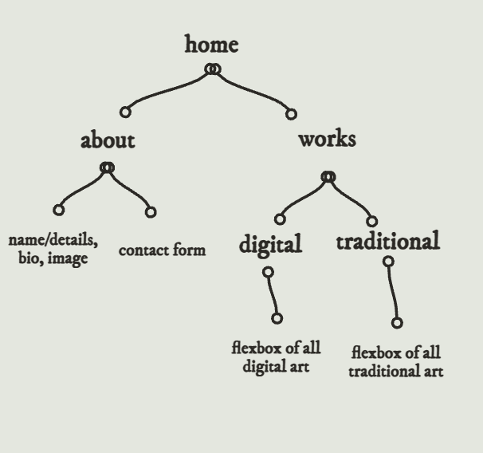

# OZDOG designs! - my portfolio

Live site: https://laraozdogan.github.io/WebDevClassNotesLO/Midterm/

## Concept

A  portfolio site for my design work. The mascot, OZDOG, is a little
guy I came up with from a riff off my last name, Ozdogan. The site is meant
to feel fun and playful.

## Sitemap

## Image sizes

- [images_before](images_before): 121.9 MB
- [images_after](images_after): 5.9 MB